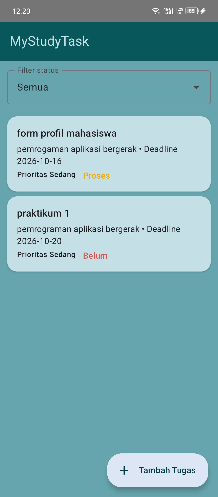
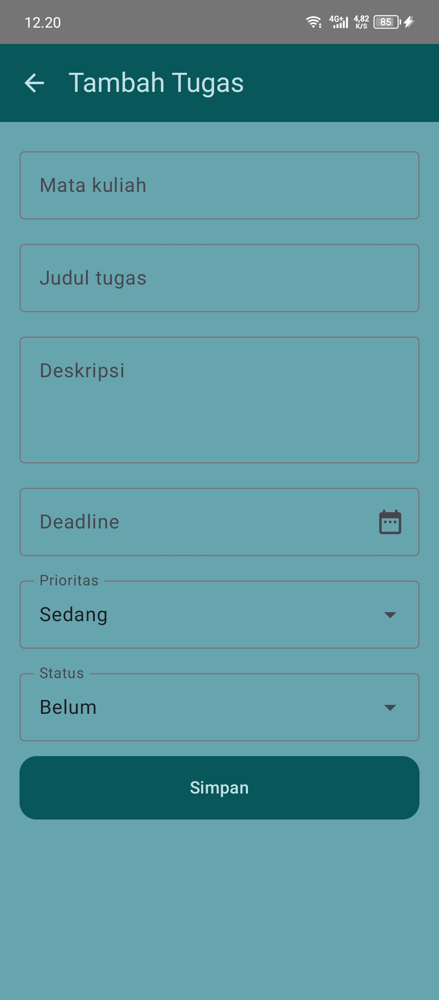
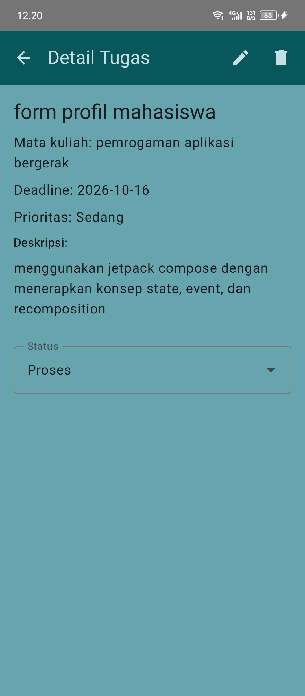
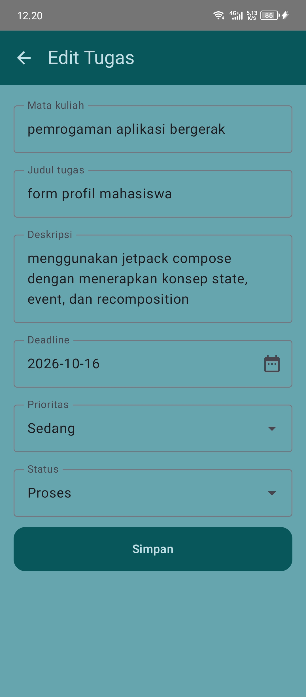
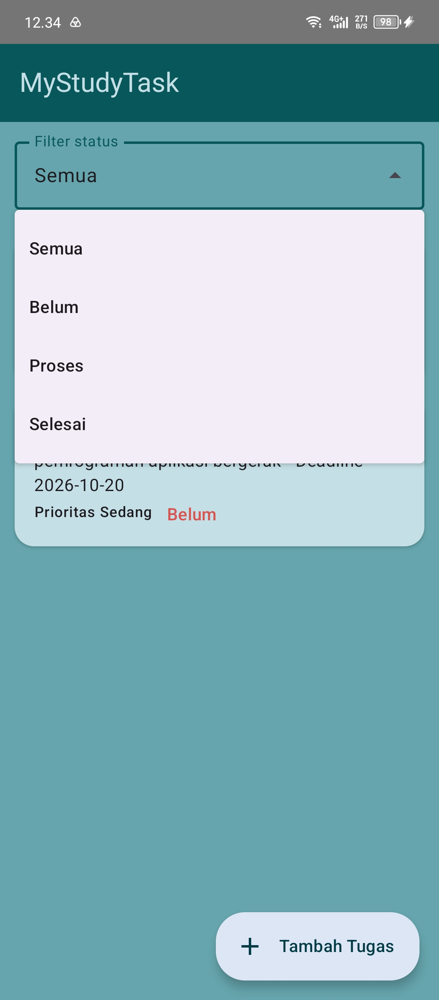
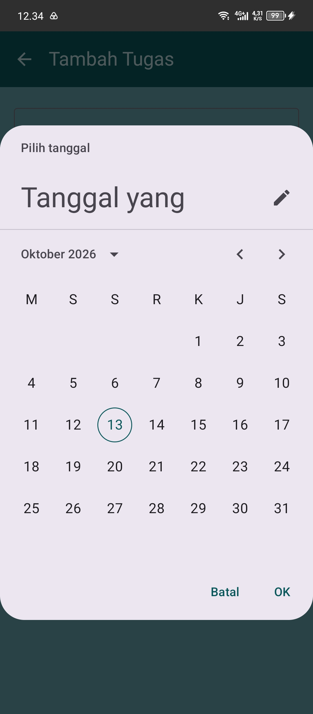
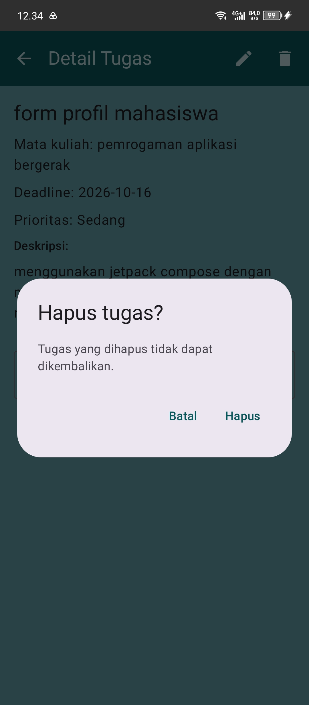

# MyStudyTask - Aplikasi Manajemen Tugas Mahasiswa (Offline)

Praktikum 1 Pemrograman Aplikasi Bergerak - Universitas Mulia.

## Deskripsi
Aplikasi Android untuk mencatat, memantau, dan memperbarui status tugas kuliah
tanpa koneksi internet. Data disimpan lokal dengan Room Database.

## Fitur
- Daftar tugas dari database lokal (urut deadline)
- Tambah tugas melalui form (dengan validasi)
- Detail tugas
- Edit tugas
- Hapus tugas dengan dialog konfirmasi
- Ubah status: Belum / Proses / Selesai
- Filter daftar berdasarkan status (fitur opsional)

## Arsitektur
Compose UI -> ViewModel -> Repository -> Room DAO -> Database

## Teknologi
Kotlin, Jetpack Compose (Material 3), Navigation Compose, ViewModel + StateFlow, Room (KSP)

## Cara menjalankan
1. Buka folder proyek di Android Studio (Koala atau lebih baru).
2. Tunggu Gradle Sync selesai.
3. Jalankan pada emulator atau perangkat (minSdk 24).
4. Matikan internet pada emulator untuk membuktikan aplikasi berjalan offline.

## Struktur
- `data/`  : Task (entity), TaskDao, AppDatabase, TaskRepository
- `ui/`    : TaskViewModel, TaskListScreen, TaskFormScreen, TaskDetailScreen, AppNav

## Screenshot

| Daftar                            | Tambah                            |
|-----------------------------------|-----------------------------------|
|  |  |

| Detail                            | Edit                          |
|-----------------------------------|-------------------------------|
|  |  |

| filter                            | deadline                              |
|-----------------------------------|---------------------------------------|
|  |  |

| konfirmasi                                |
|-------------------------------------------|
|  | 

